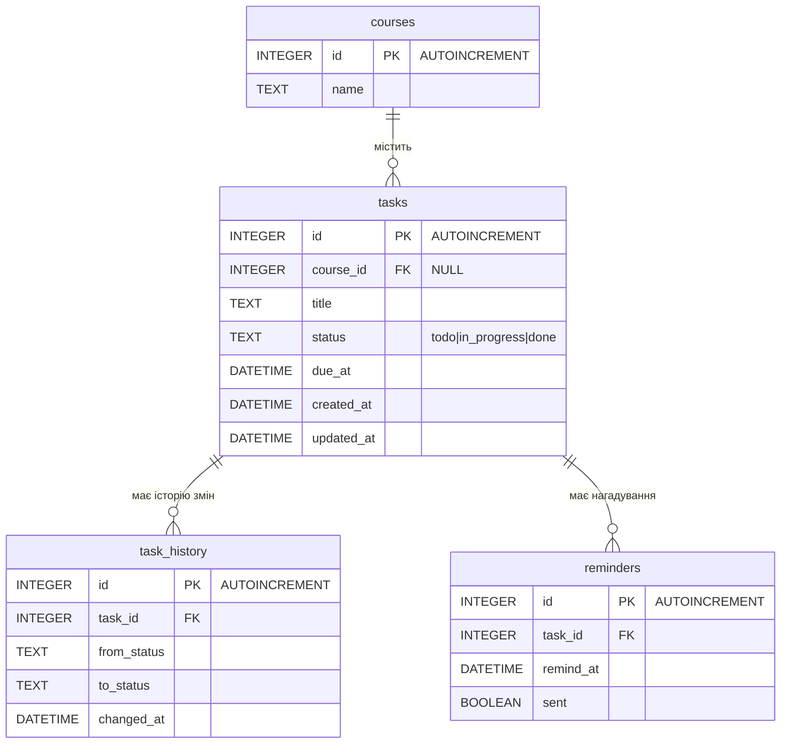

# Журнал промптів

Кожен запис: дата, мета, промпт (дослівно), результат. Оновлення цього файлу в PR перевіряє C11 (`make log-check`).

Повні журнали сесій — у `ai/sessions/`.

# Сесія 1 — стандарти проєкту (`ai/sessions/01_Standards.txt`)

## 2026-10-14 — Стандарти й документація DeadlineHub

**Мета:** створити README.md, `standards/spec.md`, `standards/definition-of-done.md`, `standards/checklist.md`.

**Промпт:**

````text
Створи файли README.md, definition-of-done.md, checklist.md, spec.md для проєкту на тему:

DeadlineHub — REST API для відстеження навчальних дедлайнів.

Основні можливості:

Створення задачі з назвою, курсом і терміном здачі (dueAt).
Перегляд задачі за id та списку задач з фільтром за статусом і курсом.
Зміна статусу задачі лише за дозволеними переходами: todo → in_progress → done (in_progress → todo дозволено, done — кінцевий).
Сортування списку за терміном здачі, позначка прострочених задач (overdue).
Історія змін статусу задачі.
(У наступних завданнях) нагадування про наближення дедлайну.

Без авторизації: один студент, без користувачів і без колаборації. Без UI — лише REST API (JSON).

Обов'язковим є використання патернів state, strategy, observer, command, repository наступним чином:

State (Стан) — у домені:
Кожен статус задачі (todo, in_progress, done) — окремий об'єкт стану, який сам знає, в які статуси можна перейти. Недозволений перехід → помилка валідації (HTTP 400).

Strategy (Стратегія) — у сервісі списку:
Сортування та фільтрація списку задач через стратегії, наприклад ByDueDateStrategy, ByStatusStrategy, OverdueOnlyStrategy. Нову стратегію можна додати без зміни сервісу.

Command (Команда) — для історії змін:
Кожна зміна задачі (створення, зміна статусу) — об'єкт команди, який виконується сервісом і записується в таблицю task_history.

Observer (Спостерігач):
Після зміни статусу сервіс повідомляє підписників: запис в історію і (у наступних завданнях) планувальник нагадувань.

Repository (Репозиторій):
Сервіси працюють з портом сховища (save, findById, list), а не з SQLite напряму. Заміна сховища не торкається бізнес-логіки.

База даних (SQLite):

Створення задачі (tasks):
Коли студент надсилає POST /tasks, бекенд валідує дані (title 3..120 символів після trim, dueAt — майбутня дата, courseId — існуючий курс або null) і створює запис у tasks зі статусом todo.

Зміна статусу та історія (task_history):
Коли студент надсилає PATCH /tasks/:id/status, бекенд знаходить задачу (404, якщо немає), перевіряє перехід через State (400, якщо заборонено), оновлює status і updated_at у tasks і в тій самій транзакції додає рядок у task_history.

Нагадування (reminders) — лише в ER, реалізація в наступних завданнях:
Для задачі можна буде створити нагадування з часом спрацювання; планувальник вибирає ті, що настали і ще не надіслані.



Філософія розробки проєкту: чим менше коду = тим менше помилок можна допустити (стосується як людей, так і ші).

Вимоги до файлів:

spec.md: розбиття на компоненти/модулі та взаємодія (таблиця «модуль — відповідальність — може залежати від»); дані та зв'язки (ER); як дані оновлюються за ключовими сценаріями; критерії прийняття з ID (AC-1, AC-2, …) і командою перевірки для кожного.
definition-of-done.md: пункти з ID (D1, D2, …), кожен перевіряється командою або в CI.
checklist.md: перелік перевірок з унікальними ID (формат, лінт, тести, smoke, збірка, аудит меж модулів) і де вони запускаються (pre-commit, pre-push, CI).
мінімальний і чистий вигляд

Структура проєкту:

/ai/sessions/
/ai/prompts-log.md
/server/domain/
/server/services/
/server/repositories/
/server/routes/
/server/db/
/server/main.js
/standards/adr
/standards/checklist.md, definition-of-done.md, spec.md
/tests/
.githooks/
Makefile
README.md
package.json
...
````

**Результат:**

- README.md: опис, можливості, стек, швидкий старт, приклади `curl`, команди, структура, посилання на стандарти.
- `standards/spec.md`: межі, таблиця модулів і заборонених залежностей, патерни, API, ER, сценарії S1–S4, критерії AC-1…AC-15 із командами перевірки.
- `standards/checklist.md`: перевірки C1–C11 і де вони запускаються (pre-commit, pre-push, CI).
- `standards/definition-of-done.md`: пункти D1–D9, прив'язані до `make`-цілей і перевірок чекліста.
- Самостійні рішення ШІ: стек Node 24 + Express 5 + `node:sqlite` + `node:test`; Command і Observer в одній транзакції (підписник `HistoryRecorder`); курси — із `seed.sql`; створення задачі пишеться в історію як `NULL → todo`; тести іменуються `AC-N:` для `make ac ID=AC-N`.

## 2026-10-14 — Перехід на Bun і Fastify

**Мета:** замінити стек Node.js + Express на Bun + Fastify і вбудовані бібліотеки Bun.

**Промпт:**

```text
Зміни стек на fastify замість express, замість node зроби bun та аналогічно замість бібліотек ноди, де можливо, вліпи бібліотеки bun
```

**Результат:**

- Runtime — Bun ≥ 1.3, HTTP — Fastify 5, БД — `bun:sqlite`, тести — `bun:test` + `app.inject()` (без запуску порту).
- `make ac ID=AC-N` → `bun test -t "AC-N:"`; покриття — `bun test --coverage` з порогом у `bunfig.toml`; збірка — `bun install --frozen-lockfile`; аудит — `bun audit`.
- Prettier, ESLint і dependency-cruiser залишено (запуск через `bunx`), бо вбудованих аналогів у Bun немає.
- Оновлено README.md, `standards/checklist.md`, `standards/spec.md` (зокрема правила меж модулів).
- Запропоновано віддати перевірку типів у запитах JSON Schema Fastify (реалізовано пізніше в ADR 0010).

## 2026-10-14 — Перевірка скрипту prepare у Bun

**Мета:** з'ясувати, чи вмикаються git-хуки автоматично на `bun install`.

**Промпт:**

```text
Перевырь як Bun запускає скрипт prepare під час bun install
```

**Результат:**

- Bun 1.3.14 запускає `prepare` з `package.json` проєкту на `bun install`, зокрема з `--frozen-lockfile`; з `--ignore-scripts` — ні. Окрема ціль `make hooks` не потрібна.
- Поза git-репозиторієм `git config` падає з кодом 128, тому в `standards/checklist.md` зафіксовано скрипт `git config core.hooksPath .githooks || true`.

# Сесія 2 — ADR (`ai/sessions/02_ADR.txt`)

## 2026-10-14 — ADR для DeadlineHub

**Мета:** задокументувати архітектурні рішення щодо стеку й інструментів у `standards/adr/`.

**Промпт:**

```text
Створи Architecture Decision Records для DeadlineHub у теці standards/adr/.

Формат:
- Шаблон: standards/adr/adr-template-minimal.md. Структуру й заголовки секцій бери з нього, не вигадуй нових.
- Назва файлу: NNNN-<feature>-choice.md. NNNN — чотиризначний порядковий номер, починаючи з 0001. <feature> — kebab-case латиницею (напр. 0001-runtime-choice.md).
- Мова — українська. Назви технологій, пакетів і команд лишай в оригіналі.
- Статус кожного ADR — Accepted, дата — сьогоднішня.
- Кожен ADR має узгоджуватися з README.md, standards/spec.md і standards/checklist.md. Посилайся на конкретні перевірки (C1–C11) і секції spec, де вони стосуються рішення. Якщо знайдеш розбіжність — не виправляй ADR мовчки, а скажи мені.
- Після створення додай у README.md (розділ «Документи») посилання на standards/adr/ і запиши цей промпт в ai/prompts-log.md (перевірка C11).

Рішення (контекст і альтернативи для кожного ADR):

1. Runtime: Bun ≥ 1.3 (ESM) — замість Node.js, щоб мати в одному бінарнику runtime, пакетний менеджер, тест-раннер і SQLite-драйвер. Це менше залежностей і конфігурації, а також відповідає філософії «менше коду — менше помилок».

2. HTTP: Fastify 5 — замість Express, бо в Fastify є вбудована валідація за JSON Schema і app.inject(), що дає API-тести без запуску порту (spec §2, tests). До того ж він має нативну підтримку ESM і async/await та менше ручного boilerplate для обробки помилок.

3. БД: вбудований bun:sqlite — замість сторонніх ORM/драйверів (Sequelize, better-sqlite3), щоб прибрати зовнішні залежності, зменшити ризик supply chain attacks (перевірка C9) і отримати максимальну швидкість «з коробки». Доступ до БД — лише з server/repositories і server/db (межі з spec §2, перевірка C3).

4. Тести: bun:test — замість Jest чи Mocha, щоб не встановлювати важкі зовнішні бібліотеки й запускати тести миттєво без додаткових конфігурацій. Покриття — вбудованим bun test --coverage з порогом у bunfig.toml (C6).

5. Лінтер: ESLint (через bunx) — замість Biome чи JSHint, бо це стандартний, перевірений часом інструмент із найбільшою екосистемою правил і плагінів (C2).

6. Форматер: Prettier (через bunx) — замість ручного форматування чи застарілих форматерів, щоб повністю автоматизувати єдиний стиль коду й не сперечатися на code review про відступи й лапки. Теж перевірений часом інструмент із великою екосистемою (C1).

7. Межі модулів: dependency-cruiser — щоб автоматично перевіряти заборонені залежності між шарами з spec §2 (domain, services, routes, repositories, db) і не покладатися на дисципліну людини чи ШІ (C3).

8. Git-хуки: власна тека .githooks + git config core.hooksPath, яку вмикає скрипт prepare у package.json — замість Husky і замість ручних скриптів у .git/hooks. Хуки поширюються через репозиторій і вмикаються автоматично на bun install, без зайвої залежності (pre-commit = make check, pre-push = make prepush).

9. Точка входу перевірок: Makefile — єдиний інтерфейс команд (make check / prepush / ci) для розробника, хуків і CI, щоб усі запускали ті самі перевірки однаковими командами.

10. Валідація вхідних даних: Ajv (вбудований у Fastify 5) + JSON Schema — замість ручної перевірки полів чи Joi/Zod. Схеми лежать у server/domain як звичайні об'єкти без імпортів (межі spec §2, C3), Fastify перевіряє за ними тіло й параметри запиту. Так немає окремої залежності, а перевірка декларативна й однакова для всіх маршрутів. Правила, які JSON Schema не виражає (довжина title після trim — AC-2, dueAt у майбутньому відносно інжектованого now — AC-3), перевіряє код у server/domain. Помилки Ajv мапляться у 400 VALIDATION_ERROR (spec §3). Альтернатива — окремий пакет ajv + ajv-formats прямо в domain — відхилена як дублювання того, що вже дає Fastify.
```

**Результат:** створено `standards/adr/0001`–`0010` (`*-choice.md`), у README.md додано посилання на `standards/adr/`. Знайдені розбіжності зі spec передано автору для рішення (ADR не змінено мовчки).

## 2026-10-14 — Розв'язання розбіжностей ADR і spec

**Мета:** усунути розбіжності між ADR і spec, знайдені під час створення ADR.

**Промпт:**

```text
Виріши сам, як тобі вважається кращим
```

**Результат:**

- spec §2: `routes` може імпортувати з `domain` лише `errors.js` і `schemas.js`; `bun:sqlite` — лише `db` і `repositories`, а підключення створює `main.js`.
- spec §5 S1: додано крок валідації за JSON Schema у Fastify; перевірку `courseId` перенесено в `CreateTaskCommand` (`services`).
- checklist: Prettier, ESLint і dependency-cruiser фіксуються в `devDependencies`, `bunx` лише їх запускає (C8, C9).
- README: `fastify.inject()` → `app.inject()`.
- Оновлено ADR 0003, 0005, 0006, 0007, 0010.

# Сесія 3 — правки після рев'ю

## 2026-10-14 — ADR без статусу, один ADR для лінтингу й форматування, чистка логів

**Мета:** виправити зауваження до ADR і прибрати шум із журналів сесій.

**Промпт:**

```text
1) adr без статусу відхилено (комбінувати все про лінтинг/форматування в один файл, тобто аля eslint prettier biome все має бути в одному файлі описано як переваги недоліки розглянуті аналоги)
2) підчистить логи аі (повидаляти Read Read Read...)

Зроби це все
```

**Результат:**

- З усіх ADR і шаблону `adr-template-minimal.md` прибрано поле `Status`.
- ADR 0005 (ESLint) і 0006 (Prettier) об'єднано в `0005-lint-format-choice.md`: ESLint + Prettier, розглянуті Biome, JSHint + ручне форматування, ESLint зі стилістичними правилами — з перевагами й недоліками кожного.
- Наступні ADR перенумеровано: 0007→0006 (межі модулів), 0008→0007 (git-хуки), 0009→0008 (Makefile), 0010→0009 (валідація); посилання оновлено. Номери ADR у записах вище — історичні.
- З `ai/sessions/*.txt` прибрано виклики інструментів (Read, Write, Update, Bash…), їхній вивід і дифи, службові рядки (`ctrl+o to expand`, `/clear`, `/bug`, recap). Лишилися промпти й відповіді.

# Сесія 4 — smoke-тест (`ai/sessions/04_Smoke.txt`)

## 2026-10-14 — Мінімальний smoke-тест

**Мета:** додати мінімальну smoke-перевірку C7 (`GET /health` → 200) і зберегти сесію в `ai/`.

**Промпт:**

```text
Зроби мінімальний смок тест, та потім імпортуй цю ж сесію в folder ai
```

**Результат:**

- `package.json` (ESM, `fastify@5`, скрипт `prepare`), `bun.lock`, `.gitignore`.
- `server/routes/health.js` — `GET /health` → `200 { "status": "ok" }`; `server/main.js` — `buildApp()` і запуск на `PORT`.
- `tests/smoke.test.js` — `bun:test` + `app.inject()`; `Makefile` — цілі `run` і `smoke`.
- БД ще немає, тож «старт на порожній БД» з C7 буде покрито, коли з'явиться `server/db`.

# Сесія 5 — коміт і PR (`ai/sessions/04_PR.txt`)

## 2026-10-14 — Коміт усього та pull request

**Мета:** закомітити весь доробок Task 1 і відкрити PR `task1 → main`.

**Промпт:**

```text
Зроби пул реквест, та закоміть це все
```

**Результат:**

- Встановлено GNU Make 4.4.1 (winget `ezwinports.make`).
- Pre-commit/pre-push хуки падають: у `Makefile` немає таргетів `check` і `prepush`. За рішенням користувача коміт і пуш зроблено з `--no-verify`.
- Коміт `ed7d8ec` «Task 1: стандарти, ADR, каркас сервера та smoke-тест», гілку `task1` запушено.
- На remote створено `main` з `13aeda6` («init branch»).
- `gh` не встановлено, тож PR треба відкрити вручну: https://github.com/respekttt/deadlinemanager/compare/main...task1?expand=1

# Сесія 6 — аудит структури й залежностей (`ai/sessions/05_Audit.txt`)

## 2026-10-14 — Аудит за spec і виправлення

**Мета:** перевірити, чи структура відповідає `standards/spec.md`, знайти зайві/неправильні залежності й виправити.

**Промпти:**

```text
Зроби Аудит: чи структура відповідає spec; топ-3 зайві/неправильні залежності.
```

```text
Виправи це все сам
```

**Результат:**

- Аудит: межі модулів не порушено, але бракувало `server/db`, конфігів інструментів, таргетів `Makefile` і CI; хуки викликали неіснуючі таргети.
- Топ-3 залежності: ESLint/Prettier/dependency-cruiser не були в `devDependencies` (`bunx` тягнув latest); `fastify: "5"` без фіксації; `make` як неописана системна залежність.
- Виправлено: точні версії в `package.json` + `engines.bun`; `eslint.config.js`, `.prettierrc.json`, `.prettierignore`, `.dependency-cruiser.cjs` (правила spec §2), `bunfig.toml` (поріг 80 %); усі таргети C1–C11 у `Makefile`; `.github/workflows/ci.yml`; `server/db` (`schema.sql`, `seed.sql`, `openDb`); smoke на порожній БД; `.gitattributes` з `eol=lf`; Markdown відформатовано Prettier.
- `make check` зелений; `make ac-check` (C5) падає, доки не реалізовано AC-1…AC-14.
- Коміт `4f88bf8`, push `task1` з `--no-verify` (за рішенням користувача; C5 блокує pre-push).

# Сесія 7 — DEFENSE і C5 за завданнями

## 2026-10-14 — DEFENSE.md і прив'язка AC до завдань

**Мета:** заповнити DEFENSE за шаблоном на основі журналів сесій; зробити C5 зеленою на етапі фундаменту, не обходячи перевірку.

**Промпти:**

```text
На основі всіх минулих сесій по промпт логам зроби defense.md по цьому шаблону: …
```

```text
нам треба make ac-check робити?
```

```text
дєлай 3
```

```text
Зроби [виправ sha в DEFENSE і додай /version], а також мене смущає [опис PR із «Відомими проблемами»] … якщо це треба змінювати, бо ми проблеми пофіксили, то зміни
```

**Результат:**

- `defense.md`: що реалізовано, топ-3 виправлень проти spec, ключове рішення (ADR 0001), результати `make smoke` / `make check` / `make ac-check`, посилання на PR #1.
- spec §6: колонка «Завдання» в таблиці AC (AC-1…AC-14 → 2, AC-15 → 1).
- `Makefile`: `TASK ?= 1`; `ac-check` (C5) бере з spec лише AC завдань ≤ `TASK`. Оновлено checklist (C5) і DoD (D3).
- Відхилено: заглушки `test.todo` (формально зелено, по суті обхід C5) і вимкнення C5.
- `GET /version` → `{ "version": "<sha>" }`: `server/routes/version.js` отримує sha від `main.js` (`GIT_SHA` або `git rev-parse --short HEAD`, інакше `unknown`). spec §3 і AC-16 (завдання 1), README, `tests/version.test.js`. `gitSha()` експортовано й покрито unit-тестом, бо поріг покриття Bun діє для кожного файлу окремо.
- Опис PR #1 оновлено: «Відомі проблеми» про хуки й незафіксовані інструменти прибрано, бо їх виправлено в сесіях 6–7.

# Сесія 8 — spec для завдання 2

## 2026-11-20 — доповнення spec.md вимогами лаби 2

**Мета:** внести у `standards/spec.md` вимоги лаби 2 (прототип, інтеграція БД, межі шарів, контекст і логер із business-process ID, глобальний обробник помилок, ідемпотентність, збої джерела, N+1). Формулювання взято з відповідей користувача на уточнювальні питання.

**Промпт (дослівно):**

```text
Доповни spec.md за вимогами лаби
• spec.md: сценарії та очікувана поведінка; схема БД, запити, сценарії помилок.
• Прототип на статичних даних (без БД): основні сценарії через зовнішній інтерфейс — HTTP API (або UI-виклики). API покриває ВСІ основні сценарії, а не один GET; схема БД без API прототипом не вважається.
• Інтеграція БД: замінити статику реальною БД; транзакції, валідація, обробка збоїв джерела, ідемпотентність/ретраї.
• Рівні декомпозиції: роути знають про HTTP; сервіси — про бізнес-операції й доступи; SQL і транзакції — лише в репозиторіях/DAO. SQL чи транзакції в роутах — порушення меж.
• Керування залежностями: без протягування 10–15 параметрів. Щонайменше: ініціалізовані ресурси (БД), користувач-ініціатор, business-process ID. Варіанти: DI, context-реєстр, AsyncLocalStorage / contextvars, Effect тощо — вибір в ADR.
• Логер, прив'язаний до business-process ID (обов'язково): кожен рядок логу з будь-якого рівня, включно з операціями з БД та їхнім результатом, містить ID … Робота без цього не приймається.
• Обробка помилок: один глобальний обробник, а не try/catch на все тіло кожної функції.
• Аудит: топ-3 зрізані кути / крайові випадки; N+1 (де виникла і як виправлено); поведінка на збоях.
• DEFENSE.md (окремий для цього завдання й легко знаходимий) + adr/ на вибір БД/ORM і керування залежностями.
```

**Уточнювальні питання AI → відповіді користувача:**

| Питання                                     | Відповідь                                                |
| ------------------------------------------- | -------------------------------------------------------- |
| Як передавати БД, ініціатора й ID запиту?   | AsyncLocalStorage                                        |
| Звідки ініціатор (користувачі поза межами)? | Заголовок `X-User-Id`, без нього — `anonymous`           |
| Що ідемпотентне?                            | `Idempotency-Key` на `POST /tasks`                       |
| Поведінка на збоях БД?                      | Без ретраїв, одразу `503`                                |
| Де N+1?                                     | Назва курсу в списку задач (`courseName`), фікс — `JOIN` |
| Як оформити прототип?                       | In-memory репозиторії з тими самими портами              |
| spec уже >1 стор. — куди писати?            | Стисло в `spec.md`                                       |

**Результат:**

- spec §1: ініціатор через `X-User-Id`; серверні ретраї поза межами.
- spec §2: `server/context.js` (ALS), `repositories/memory/`, «Залежності, контекст і логування», без `try/catch` у роутах, посилання на ADR 0010 (ще не написаний).
- spec §3: `courseName`, заголовки, коди `409`/`503`/`500`, `requestId` у тілі помилки.
- spec §4: `task_history.changed_by`, таблиця `idempotency_keys`, таблиця SQL-запитів за портами.
- spec §5: ідемпотентність у S1, N+1 у S3, таблиця сценаріїв помилок, етапи «прототип → БД».
- spec §6: AC-17…AC-23 (завдання 2).

## 2026-11-20 — ADR 0010 і виправлення spec

**Промпти (дослівно):**

```text
Гілку я вже створив, закоміть
```

```text
Напиши ADR 10 і виправ spec
```

**Відповідь користувача на питання AI:** pre-commit падав через незакомічений DoD → «Додати в .prettierignore».

**Результат:**

- `standards/adr/0010-dependency-context-choice.md`: AsyncLocalStorage для контексту й логера, ресурси через конструктор. Варіанти — ті три, що пропонувалися користувачу (ALS, явний `ctx`, `awilix`), з плюсами й мінусами. У Decision Drivers прямо записано, що варіант запропонував AI, а обрав користувач.
- spec виправлено (AI знайшов розбіжності):
  - логер: замість pino `mixin` в ALS кладеться `request.log.child({ userId })`, бо `services` не можуть імпортувати `fastify`;
  - помилки драйвера в `repositories` мапляться на `SourceUnavailableError`;
  - невалідний запит не займає `Idempotency-Key` (AC-18);
  - `IdempotencyRepository` додано в порти, `context` — у залежності `services` і `repositories`;
  - AC-23: заборону SQL у роутах перевіряє C3 (імпорти), а не ESLint.
- spec стиснуто з 204 до 138 рядків: ER-діаграма лише зі зв'язками + таблиця колонок, деталі контексту винесено в ADR 0010, запити — списком.

## 2026-11-20 — схема, правила перевірок і прототип на in-memory репозиторіях

**Промпт (дослівно):**

```text
Роби
```

(відповідь на пропозицію AI: «оновити `schema.sql` … і правила в `.dependency-cruiser.cjs` та `eslint.config.js`. Після цього можна братися за прототип на in-memory репозиторіях».)

**Результат:**

- `schema.sql`: `task_history.changed_by`, таблиця `idempotency_keys`; `openDb` вмикає `journal_mode = WAL`.
- C3: правила `context-isolated` і `repositories-no-upper-layers`. C2: `no-restricted-syntax` забороняє `try/catch` у `server/routes` (AC-23).
- Прототип (spec §5, «Етапи», крок 1): `domain` (Task, State, схеми, помилки), `services` (TaskService, команди, стратегії, EventBus, HistoryRecorder), `context.js` (ALS), `repositories/memory`, `routes/tasks.js`, `main.js` (хук `onRequest`, `setErrorHandler`, `setNotFoundHandler`).
- Тести на прототипі: AC-1…AC-14, AC-17…AC-20. AC-21 і AC-22 — на етапі БД. `TASK` у `Makefile` лишається `1`, доки їх немає.
- Знахідки AI під час перевірки:
  - Bun без явного `functions` у `coverageThreshold` перевіряє і покриття функцій, а неявний конструктор класу рахує непокритою функцією. Стани переписано на об'єкти, `EventBus` отримав явний конструктор; поріг не послаблювали.
  - `requestIdLogLabel` у Fastify 5 застарів, замінено на `LogController`.

## 2026-11-20 — інтеграція БД (етап 2)

**Промпт (дослівно):**

```text
Зроби
 інтеграція БД:
- SQLite-репозиторії з тими самими портами;
- перетворення помилок драйвера на 503;
- тести AC-21 і AC-22;
- після цього — TASK = 2 у Makefile.
```

**Питання AI → відповідь користувача:**

| Питання                                                                                                                                       | Відповідь               |
| --------------------------------------------------------------------------------------------------------------------------------------------- | ----------------------- |
| Гонка за `Idempotency-Key` між `find` і `insert` (лише з кількома процесами на одній БД): лишити `409` і змінити spec чи робити як у spec S1? | «Реалізувати як у spec» |

**Результат:**

- `server/repositories/sqlite`: порти на `bun:sqlite`; `TaskRepository.list` — один `SELECT … LEFT JOIN courses` (без N+1); кожен SQL-виклик логується (`op`, `rows`, `ms` або код помилки); `transaction` логує commit/rollback.
- `isSourceFailure`: `SQLITE_BUSY|LOCKED|IOERR|CANTOPEN|FULL|READONLY` і закрите підключення → `SourceUnavailableError` (`503`), без ретраїв; інші помилки драйвера → `500`.
- Гонка ключа: дубль PK → внутрішня `IdempotencyRaceError` → `TaskService` один раз перезапускає команду → replay (`201` з тією самою задачею або `409`).
- `main.js`: з `db` — SQLite-репозиторії, без `db` — in-memory.
- Тести: API-набір (AC-1…AC-20) проходить на обох сховищах; `tests/db.test.js` — AC-21 (закрите підключення, `SQLITE_BUSY` через друге підключення з `BEGIN IMMEDIATE`, `DROP TABLE` → `500`), AC-22 (один SQL-запит на 5 задач), гонка ключа.
- `TASK ?= 2` у `Makefile`; `make ci` зелений (84 тести).
- Під час перевірки виявлено: форму помилок `bun:sqlite` (`SQLiteError.code`, `RangeError` для закритої БД) з'ясовано пробним скриптом перед реалізацією.
