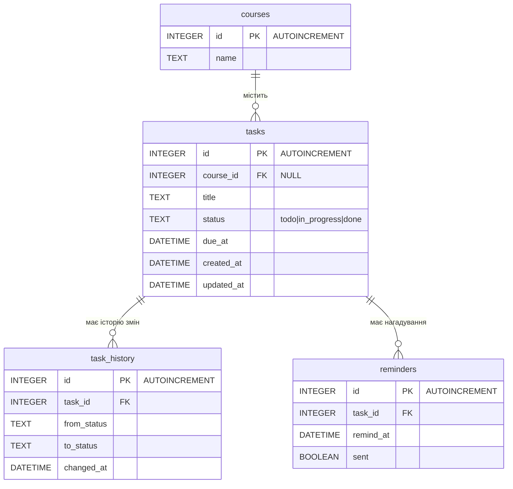

# Журнал промптів

Кожен запис: дата, мета, промпт (дослівно), результат. Оновлення цього файлу в PR перевіряє C11 (`make log-check`).

Повні журнали сесій — у `ai/sessions/`.

# Сесія 1 — стандарти проєкту (`ai/sessions/01_Standards.txt`)

## 2026-10-14 — Стандарти й документація DeadlineHub

**Мета:** створити README.md, `standards/spec.md`, `standards/definition-of-done.md`, `standards/checklist.md`.

**Промпт:**

````text
Створи файли README.md, definition-of-done.md, checklist.md, spec.md для проєкту на тему:

DeadlineHub — REST API для відстеження навчальних дедлайнів.

Основні можливості:

Створення задачі з назвою, курсом і терміном здачі (dueAt).
Перегляд задачі за id та списку задач з фільтром за статусом і курсом.
Зміна статусу задачі лише за дозволеними переходами: todo → in_progress → done (in_progress → todo дозволено, done — кінцевий).
Сортування списку за терміном здачі, позначка прострочених задач (overdue).
Історія змін статусу задачі.
(У наступних завданнях) нагадування про наближення дедлайну.

Без авторизації: один студент, без користувачів і без колаборації. Без UI — лише REST API (JSON).

Обов'язковим є використання патернів state, strategy, observer, command, repository наступним чином:

State (Стан) — у домені:
Кожен статус задачі (todo, in_progress, done) — окремий об'єкт стану, який сам знає, в які статуси можна перейти. Недозволений перехід → помилка валідації (HTTP 400).

Strategy (Стратегія) — у сервісі списку:
Сортування та фільтрація списку задач через стратегії, наприклад ByDueDateStrategy, ByStatusStrategy, OverdueOnlyStrategy. Нову стратегію можна додати без зміни сервісу.

Command (Команда) — для історії змін:
Кожна зміна задачі (створення, зміна статусу) — об'єкт команди, який виконується сервісом і записується в таблицю task_history.

Observer (Спостерігач):
Після зміни статусу сервіс повідомляє підписників: запис в історію і (у наступних завданнях) планувальник нагадувань.

Repository (Репозиторій):
Сервіси працюють з портом сховища (save, findById, list), а не з SQLite напряму. Заміна сховища не торкається бізнес-логіки.

База даних (SQLite):

Створення задачі (tasks):
Коли студент надсилає POST /tasks, бекенд валідує дані (title 3..120 символів після trim, dueAt — майбутня дата, courseId — існуючий курс або null) і створює запис у tasks зі статусом todo.

Зміна статусу та історія (task_history):
Коли студент надсилає PATCH /tasks/:id/status, бекенд знаходить задачу (404, якщо немає), перевіряє перехід через State (400, якщо заборонено), оновлює status і updated_at у tasks і в тій самій транзакції додає рядок у task_history.

Нагадування (reminders) — лише в ER, реалізація в наступних завданнях:
Для задачі можна буде створити нагадування з часом спрацювання; планувальник вибирає ті, що настали і ще не надіслані.



Філософія розробки проєкту: чим менше коду = тим менше помилок можна допустити (стосується як людей, так і ші).

Вимоги до файлів:

spec.md: розбиття на компоненти/модулі та взаємодія (таблиця «модуль — відповідальність — може залежати від»); дані та зв'язки (ER); як дані оновлюються за ключовими сценаріями; критерії прийняття з ID (AC-1, AC-2, …) і командою перевірки для кожного.
definition-of-done.md: пункти з ID (D1, D2, …), кожен перевіряється командою або в CI.
checklist.md: перелік перевірок з унікальними ID (формат, лінт, тести, smoke, збірка, аудит меж модулів) і де вони запускаються (pre-commit, pre-push, CI).
мінімальний і чистий вигляд

Структура проєкту:

/ai/sessions/
/ai/prompts-log.md
/server/domain/
/server/services/
/server/repositories/
/server/routes/
/server/db/
/server/main.js
/standards/adr
/standards/checklist.md, definition-of-done.md, spec.md
/tests/
.githooks/
Makefile
README.md
package.json
...
````

**Результат:**
- README.md: опис, можливості, стек, швидкий старт, приклади `curl`, команди, структура, посилання на стандарти.
- `standards/spec.md`: межі, таблиця модулів і заборонених залежностей, патерни, API, ER, сценарії S1–S4, критерії AC-1…AC-15 із командами перевірки.
- `standards/checklist.md`: перевірки C1–C11 і де вони запускаються (pre-commit, pre-push, CI).
- `standards/definition-of-done.md`: пункти D1–D9, прив'язані до `make`-цілей і перевірок чекліста.
- Самостійні рішення ШІ: стек Node 24 + Express 5 + `node:sqlite` + `node:test`; Command і Observer в одній транзакції (підписник `HistoryRecorder`); курси — із `seed.sql`; створення задачі пишеться в історію як `NULL → todo`; тести іменуються `AC-N:` для `make ac ID=AC-N`.

## 2026-10-14 — Перехід на Bun і Fastify

**Мета:** замінити стек Node.js + Express на Bun + Fastify і вбудовані бібліотеки Bun.

**Промпт:**

```text
Зміни стек на fastify замість express, замість node зроби bun та аналогічно замість бібліотек ноди, де можливо, вліпи бібліотеки bun
```

**Результат:**
- Runtime — Bun ≥ 1.3, HTTP — Fastify 5, БД — `bun:sqlite`, тести — `bun:test` + `app.inject()` (без запуску порту).
- `make ac ID=AC-N` → `bun test -t "AC-N:"`; покриття — `bun test --coverage` з порогом у `bunfig.toml`; збірка — `bun install --frozen-lockfile`; аудит — `bun audit`.
- Prettier, ESLint і dependency-cruiser залишено (запуск через `bunx`), бо вбудованих аналогів у Bun немає.
- Оновлено README.md, `standards/checklist.md`, `standards/spec.md` (зокрема правила меж модулів).
- Запропоновано віддати перевірку типів у запитах JSON Schema Fastify (реалізовано пізніше в ADR 0010).

## 2026-10-14 — Перевірка скрипту prepare у Bun

**Мета:** з'ясувати, чи вмикаються git-хуки автоматично на `bun install`.

**Промпт:**

```text
Перевырь як Bun запускає скрипт prepare під час bun install
```

**Результат:**
- Bun 1.3.14 запускає `prepare` з `package.json` проєкту на `bun install`, зокрема з `--frozen-lockfile`; з `--ignore-scripts` — ні. Окрема ціль `make hooks` не потрібна.
- Поза git-репозиторієм `git config` падає з кодом 128, тому в `standards/checklist.md` зафіксовано скрипт `git config core.hooksPath .githooks || true`.

# Сесія 2 — ADR (`ai/sessions/02_ADR.txt`)

## 2026-10-14 — ADR для DeadlineHub

**Мета:** задокументувати архітектурні рішення щодо стеку й інструментів у `standards/adr/`.

**Промпт:**

```text
Створи Architecture Decision Records для DeadlineHub у теці standards/adr/.

Формат:
- Шаблон: standards/adr/adr-template-minimal.md. Структуру й заголовки секцій бери з нього, не вигадуй нових.
- Назва файлу: NNNN-<feature>-choice.md. NNNN — чотиризначний порядковий номер, починаючи з 0001. <feature> — kebab-case латиницею (напр. 0001-runtime-choice.md).
- Мова — українська. Назви технологій, пакетів і команд лишай в оригіналі.
- Статус кожного ADR — Accepted, дата — сьогоднішня.
- Кожен ADR має узгоджуватися з README.md, standards/spec.md і standards/checklist.md. Посилайся на конкретні перевірки (C1–C11) і секції spec, де вони стосуються рішення. Якщо знайдеш розбіжність — не виправляй ADR мовчки, а скажи мені.
- Після створення додай у README.md (розділ «Документи») посилання на standards/adr/ і запиши цей промпт в ai/prompts-log.md (перевірка C11).

Рішення (контекст і альтернативи для кожного ADR):

1. Runtime: Bun ≥ 1.3 (ESM) — замість Node.js, щоб мати в одному бінарнику runtime, пакетний менеджер, тест-раннер і SQLite-драйвер. Це менше залежностей і конфігурації, а також відповідає філософії «менше коду — менше помилок».

2. HTTP: Fastify 5 — замість Express, бо в Fastify є вбудована валідація за JSON Schema і app.inject(), що дає API-тести без запуску порту (spec §2, tests). До того ж він має нативну підтримку ESM і async/await та менше ручного boilerplate для обробки помилок.

3. БД: вбудований bun:sqlite — замість сторонніх ORM/драйверів (Sequelize, better-sqlite3), щоб прибрати зовнішні залежності, зменшити ризик supply chain attacks (перевірка C9) і отримати максимальну швидкість «з коробки». Доступ до БД — лише з server/repositories і server/db (межі з spec §2, перевірка C3).

4. Тести: bun:test — замість Jest чи Mocha, щоб не встановлювати важкі зовнішні бібліотеки й запускати тести миттєво без додаткових конфігурацій. Покриття — вбудованим bun test --coverage з порогом у bunfig.toml (C6).

5. Лінтер: ESLint (через bunx) — замість Biome чи JSHint, бо це стандартний, перевірений часом інструмент із найбільшою екосистемою правил і плагінів (C2).

6. Форматер: Prettier (через bunx) — замість ручного форматування чи застарілих форматерів, щоб повністю автоматизувати єдиний стиль коду й не сперечатися на code review про відступи й лапки. Теж перевірений часом інструмент із великою екосистемою (C1).

7. Межі модулів: dependency-cruiser — щоб автоматично перевіряти заборонені залежності між шарами з spec §2 (domain, services, routes, repositories, db) і не покладатися на дисципліну людини чи ШІ (C3).

8. Git-хуки: власна тека .githooks + git config core.hooksPath, яку вмикає скрипт prepare у package.json — замість Husky і замість ручних скриптів у .git/hooks. Хуки поширюються через репозиторій і вмикаються автоматично на bun install, без зайвої залежності (pre-commit = make check, pre-push = make prepush).

9. Точка входу перевірок: Makefile — єдиний інтерфейс команд (make check / prepush / ci) для розробника, хуків і CI, щоб усі запускали ті самі перевірки однаковими командами.

10. Валідація вхідних даних: Ajv (вбудований у Fastify 5) + JSON Schema — замість ручної перевірки полів чи Joi/Zod. Схеми лежать у server/domain як звичайні об'єкти без імпортів (межі spec §2, C3), Fastify перевіряє за ними тіло й параметри запиту. Так немає окремої залежності, а перевірка декларативна й однакова для всіх маршрутів. Правила, які JSON Schema не виражає (довжина title після trim — AC-2, dueAt у майбутньому відносно інжектованого now — AC-3), перевіряє код у server/domain. Помилки Ajv мапляться у 400 VALIDATION_ERROR (spec §3). Альтернатива — окремий пакет ajv + ajv-formats прямо в domain — відхилена як дублювання того, що вже дає Fastify.
```

**Результат:** створено `standards/adr/0001`–`0010` (`*-choice.md`), у README.md додано посилання на `standards/adr/`. Знайдені розбіжності зі spec передано автору для рішення (ADR не змінено мовчки).

## 2026-10-14 — Розв'язання розбіжностей ADR і spec

**Мета:** усунути розбіжності між ADR і spec, знайдені під час створення ADR.

**Промпт:**

```text
Виріши сам, як тобі вважається кращим
```

**Результат:**
- spec §2: `routes` може імпортувати з `domain` лише `errors.js` і `schemas.js`; `bun:sqlite` — лише `db` і `repositories`, а підключення створює `main.js`.
- spec §5 S1: додано крок валідації за JSON Schema у Fastify; перевірку `courseId` перенесено в `CreateTaskCommand` (`services`).
- checklist: Prettier, ESLint і dependency-cruiser фіксуються в `devDependencies`, `bunx` лише їх запускає (C8, C9).
- README: `fastify.inject()` → `app.inject()`.
- Оновлено ADR 0003, 0005, 0006, 0007, 0010.

# Сесія 3 — правки після рев'ю

## 2026-10-14 — ADR без статусу, один ADR для лінтингу й форматування, чистка логів

**Мета:** виправити зауваження до ADR і прибрати шум із журналів сесій.

**Промпт:**

```text
1) adr без статусу відхилено (комбінувати все про лінтинг/форматування в один файл, тобто аля eslint prettier biome все має бути в одному файлі описано як переваги недоліки розглянуті аналоги)
2) підчистить логи аі (повидаляти Read Read Read...)

Зроби це все
```

**Результат:**
- З усіх ADR і шаблону `adr-template-minimal.md` прибрано поле `Status`.
- ADR 0005 (ESLint) і 0006 (Prettier) об'єднано в `0005-lint-format-choice.md`: ESLint + Prettier, розглянуті Biome, JSHint + ручне форматування, ESLint зі стилістичними правилами — з перевагами й недоліками кожного.
- Наступні ADR перенумеровано: 0007→0006 (межі модулів), 0008→0007 (git-хуки), 0009→0008 (Makefile), 0010→0009 (валідація); посилання оновлено. Номери ADR у записах вище — історичні.
- З `ai/sessions/*.txt` прибрано виклики інструментів (Read, Write, Update, Bash…), їхній вивід і дифи, службові рядки (`ctrl+o to expand`, `/clear`, `/bug`, recap). Лишилися промпти й відповіді.

# Сесія 4 — smoke-тест (`ai/sessions/04_Smoke.txt`)

## 2026-10-14 — Мінімальний smoke-тест

**Мета:** додати мінімальну smoke-перевірку C7 (`GET /health` → 200) і зберегти сесію в `ai/`.

**Промпт:**

```text
Зроби мінімальний смок тест, та потім імпортуй цю ж сесію в folder ai
```

**Результат:**
- `package.json` (ESM, `fastify@5`, скрипт `prepare`), `bun.lock`, `.gitignore`.
- `server/routes/health.js` — `GET /health` → `200 { "status": "ok" }`; `server/main.js` — `buildApp()` і запуск на `PORT`.
- `tests/smoke.test.js` — `bun:test` + `app.inject()`; `Makefile` — цілі `run` і `smoke`.
- БД ще немає, тож «старт на порожній БД» з C7 буде покрито, коли з'явиться `server/db`.
