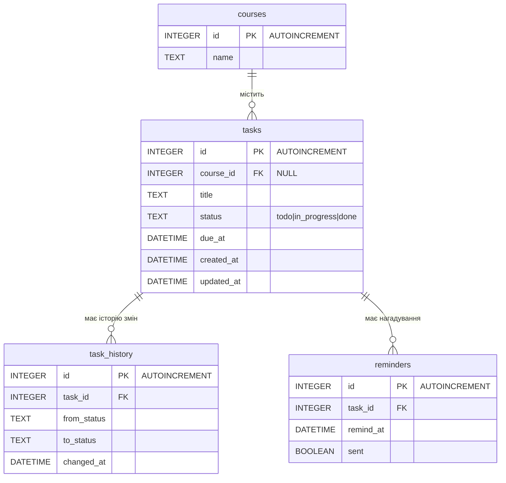

# DeadlineHub — специфікація

## 1. Межі

- **У межах:** REST API (JSON) для задач одного студента: створення, перегляд, список, зміна статусу, історія.
- **Поза межами:** авторизація, користувачі, колаборація, UI, CRUD курсів через API (курси — із `server/db/seed.sql`).
- **Наступні завдання:** нагадування (`reminders`) — зараз лише таблиця в схемі.

## 2. Модулі та взаємодія

| Модуль                | Відповідальність                                                                                                                           | Може залежати від                                      |
| --------------------- | ------------------------------------------------------------------------------------------------------------------------------------------ | ------------------------------------------------------ |
| `server/domain`       | `Task`, об'єкти станів, валідація вхідних даних (JSON Schema у `domain/schemas.js` і правила в коді), доменні помилки (`domain/errors.js`) | —                                                      |
| `server/services`     | `TaskService`: виконання команд, список через стратегії, публікація подій; опис портів сховища                                             | `domain`                                               |
| `server/repositories` | SQLite-реалізації портів, `transaction(fn)`                                                                                                | `domain`, `db`                                         |
| `server/db`           | підключення `bun:sqlite`, `schema.sql`, `seed.sql`, ініціалізація схеми                                                                    | —                                                      |
| `server/routes`       | HTTP: розбір запиту, валідація за JSON Schema (Ajv у Fastify), виклик сервісу, мапінг помилок у статуси                                    | `services`, `domain` (лише `errors.js` і `schemas.js`) |
| `server/main.js`      | composition root: створює репозиторії, реєструє стратегії й підписників, запускає Fastify                                                  | усі                                                    |
| `tests`               | unit (domain, services з in-memory репозиторіями) і API-тести через `app.inject()` на `bun:test`                                           | усі                                                    |

Заборонені залежності (перевірка `C3`): `domain` → будь-що з `server/`, `fastify`, `bun:sqlite`; `services` → `repositories`, `db`, `routes`, `fastify`, `bun:sqlite`; `routes` → `repositories`, `db`, будь-що з `domain`, крім `domain/errors.js` і `domain/schemas.js`. `bun:sqlite` імпортують лише `server/db` і `server/repositories`; підключення створює `main.js` через `server/db`.

### Патерни

| Патерн         | Де                                                        | Контракт                                                                                                                                                                                                         |
| -------------- | --------------------------------------------------------- | ---------------------------------------------------------------------------------------------------------------------------------------------------------------------------------------------------------------- |
| **State**      | `domain/states.js`                                        | `TodoState`, `InProgressState`, `DoneState` з `canTransitionTo(status)`. `task.changeStatus(to)` делегує поточному стану; заборонений перехід → `InvalidTransitionError` (400).                                  |
| **Strategy**   | `services/strategies/`                                    | `{ apply(tasks, { now }) → tasks }`: `StatusFilter`, `CourseFilter`, `OverdueOnly`, `ByDueDate`. Сервіс отримує реєстр «параметр запиту → стратегія» з `main.js`; нова стратегія = новий файл + рядок у реєстрі. |
| **Command**    | `services/commands/`                                      | `CreateTaskCommand`, `ChangeStatusCommand`: `execute({ repos, now }) → event`. `TaskService.run(command)` виконує команду в транзакції.                                                                          |
| **Observer**   | `services/events.js`                                      | `subscribe(type, fn)`, `publish(event)`. Підписники: `HistoryRecorder` (синхронно, в тій самій транзакції); `ReminderScheduler` — у наступних завданнях.                                                         |
| **Repository** | порти в `services/ports.js`, реалізації в `repositories/` | `TaskRepository { save, findById, list }`, `CourseRepository { findById }`, `HistoryRepository { append, listByTaskId }`, `transaction(fn)`.                                                                     |

## 3. API

| Метод і шлях              | Тіло / параметри                                                      | Успіх                      | Помилки      |
| ------------------------- | --------------------------------------------------------------------- | -------------------------- | ------------ |
| `POST /tasks`             | `{ title, dueAt, courseId? }`                                         | `201` задача               | `400`        |
| `GET /tasks/:id`          | —                                                                     | `200` задача               | `404`        |
| `GET /tasks`              | `status`, `courseId`, `overdue=true`, `sort=dueAt` (за замовчуванням) | `200` масив                | `400`        |
| `PATCH /tasks/:id/status` | `{ status }`                                                          | `200` задача               | `400`, `404` |
| `GET /tasks/:id/history`  | —                                                                     | `200` масив за `changedAt` | `404`        |
| `GET /health`             | —                                                                     | `200 { "status": "ok" }`   | —            |

```json
{
  "id": 1,
  "title": "Лабораторна 3",
  "courseId": 1,
  "status": "todo",
  "dueAt": "2026-12-01T21:00:00.000Z",
  "createdAt": "…",
  "updatedAt": "…",
  "overdue": false
}
```

- `overdue = status ≠ done && dueAt < now` — обчислюється, не зберігається.
- Помилка: `{ "error": { "code": "VALIDATION_ERROR" | "INVALID_TRANSITION" | "NOT_FOUND", "message": "…" } }`.
- Усі часи — ISO 8601 UTC. Час (`now`) інжектується в сервіс, щоб тести були детермінованими.

## 4. Дані



Обмеження: `PRAGMA foreign_keys = ON`; `tasks.status` — `CHECK IN ('todo','in_progress','done') DEFAULT 'todo'`; `task_history.from_status` — `NULL` для запису про створення; `reminders.sent` — `DEFAULT 0`.

## 5. Оновлення даних за сценаріями

**S1. Створення задачі — `POST /tasks`**

1. Fastify перевіряє тіло за JSON Schema з `domain/schemas.js` (типи, обов'язкові поля, формат `dueAt`). Порушення → `400 VALIDATION_ERROR`, сервіс не викликається.
2. `routes` передає тіло в `TaskService.run(new CreateTaskCommand(input))`.
3. Валідація в `domain` (правила, які JSON Schema не виражає): `title` 3..120 символів після `trim`; `dueAt > now`. Перевірка в `CreateTaskCommand` (`services`): `courseId` — `null`/відсутній або існує (`CourseRepository.findById`). Порушення → `400`, нічого не записано.
4. Транзакція: `INSERT tasks` (`status = 'todo'`, `created_at = updated_at = now`) → подія `task.created` → `HistoryRecorder`: `INSERT task_history (NULL → 'todo')`.
5. `201` + задача.

**S2. Зміна статусу — `PATCH /tasks/:id/status`**

1. `TaskService.run(new ChangeStatusCommand(id, status))`.
2. `TaskRepository.findById` → немає → `404`.
3. `task.changeStatus(status)` через State → заборонено → `400`, нічого не змінено.
4. Транзакція: `UPDATE tasks SET status, updated_at = now` → подія `task.status_changed` → `HistoryRecorder`: `INSERT task_history (from → to)`. Помилка будь-якого кроку → відкат обох.
5. `200` + задача.

**S3. Список — `GET /tasks`** — лише читання: `TaskRepository.list()` → стратегії з реєстру за параметрами запиту по черзі → `overdue` для кожної задачі.

**S4. Історія — `GET /tasks/:id/history`** — лише читання: `404`, якщо задачі немає; інакше `HistoryRepository.listByTaskId`.

## 6. Критерії прийняття

Назва кожного тесту починається з `AC-N:`. Перевірка одного критерію: `make ac ID=AC-N` (`bun test -t "AC-N:"`).

| ID    | Критерій                                                                                                                       | Перевірка          |
| ----- | ------------------------------------------------------------------------------------------------------------------------------ | ------------------ |
| AC-1  | `POST /tasks` з валідними даними → `201`, `status = todo`, у `task_history` один запис `NULL → todo`.                          | `make ac ID=AC-1`  |
| AC-2  | `title` коротший за 3 або довший за 120 символів після `trim` → `400 VALIDATION_ERROR`, у БД нічого не записано.               | `make ac ID=AC-2`  |
| AC-3  | `dueAt` відсутній, некоректний або не в майбутньому → `400 VALIDATION_ERROR`.                                                  | `make ac ID=AC-3`  |
| AC-4  | Неіснуючий `courseId` → `400`; `courseId` відсутній або `null` → `201` з `courseId: null`.                                     | `make ac ID=AC-4`  |
| AC-5  | `GET /tasks/:id` → `200` для існуючої задачі, `404 NOT_FOUND` для неіснуючої.                                                  | `make ac ID=AC-5`  |
| AC-6  | `GET /tasks?status=…&courseId=…` повертає лише задачі, що відповідають усім фільтрам; невідоме значення `status` → `400`.      | `make ac ID=AC-6`  |
| AC-7  | Список відсортовано за `dueAt` за зростанням; `overdue = true` лише для невиконаних задач із `dueAt < now`.                    | `make ac ID=AC-7`  |
| AC-8  | `GET /tasks?overdue=true` повертає лише прострочені задачі.                                                                    | `make ac ID=AC-8`  |
| AC-9  | Переходи `todo→in_progress`, `in_progress→done`, `in_progress→todo` → `200`, `updatedAt` оновлено.                             | `make ac ID=AC-9`  |
| AC-10 | `todo→done`, будь-який перехід із `done`, перехід у той самий або невідомий статус → `400`, `tasks` і `task_history` без змін. | `make ac ID=AC-10` |
| AC-11 | `PATCH /tasks/:id/status` для неіснуючої задачі → `404`.                                                                       | `make ac ID=AC-11` |
| AC-12 | Якщо запис в історію падає, статус задачі не змінюється (одна транзакція).                                                     | `make ac ID=AC-12` |
| AC-13 | `GET /tasks/:id/history` повертає всі зміни в хронологічному порядку; `404` для неіснуючої задачі.                             | `make ac ID=AC-13` |
| AC-14 | Нова стратегія, зареєстрована в тесті, застосовується без зміни `TaskService`.                                                 | `make ac ID=AC-14` |
| AC-15 | Межі модулів із розділу 2 не порушено.                                                                                         | `make boundaries`  |
