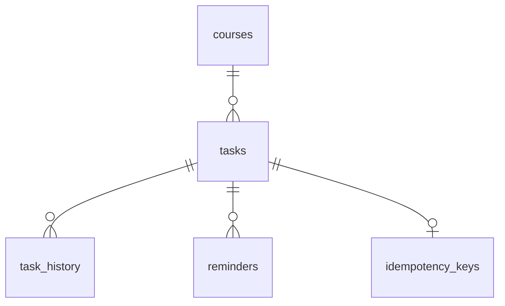

# DeadlineHub — специфікація

## 1. Межі

- **У межах:** REST API (JSON) для задач одного студента: створення, перегляд, список, зміна статусу, історія.
- **Ініціатор:** заголовок `X-User-Id` без перевірки (без нього — `anonymous`); пишеться в лог і в `task_history.changed_by`.
- **Поза межами:** авторизація, таблиця користувачів, колаборація, UI, CRUD курсів (курси — із `server/db/seed.sql`), серверні ретраї (повтор робить клієнт, безпечно завдяки `Idempotency-Key`).
- **Наступні завдання:** нагадування (`reminders`) — зараз лише таблиця в схемі.

## 2. Модулі та взаємодія

| Модуль                | Відповідальність                                                                                                                    | Може залежати від                                      |
| --------------------- | ----------------------------------------------------------------------------------------------------------------------------------- | ------------------------------------------------------ |
| `server/domain`       | `Task`, стани, валідація (JSON Schema в `domain/schemas.js` + правила в коді), доменні помилки (`domain/errors.js`)                 | —                                                      |
| `server/services`     | `TaskService`: команди, стратегії, події; порти сховища; бізнес-логи                                                                | `domain`, `context`                                    |
| `server/repositories` | **лише тут SQL і транзакції**; помилки драйвера → `SourceUnavailableError`; лог кожного SQL. `memory/` — in-memory реалізації       | `domain`, `db`, `context`                              |
| `server/context.js`   | `AsyncLocalStorage`: `{ requestId, userId, log }`, `getContext()`, проксі `log` (ADR 0010)                                          | —                                                      |
| `server/db`           | підключення `bun:sqlite`, `schema.sql`, `seed.sql`                                                                                  | —                                                      |
| `server/routes`       | HTTP: запит, заголовки, JSON Schema (Ajv), виклик сервісу; без `try/catch`                                                          | `services`, `domain` (лише `errors.js` і `schemas.js`) |
| `server/main.js`      | composition root: БД і репозиторії → конструктор `TaskService`; стратегії, підписники; хуки `onRequest`/`onSend`; `setErrorHandler` | усі                                                    |
| `tests`               | unit (domain, services на `memory/`) і API-тести через `app.inject()` на `bun:test`                                                 | усі                                                    |

Заборонені залежності (C3): `domain` → `server/*`, `fastify`, `bun:sqlite`; `services` → `repositories`, `db`, `routes`, `fastify`, `bun:sqlite`; `routes` → `repositories`, `db`, `domain/*` крім `errors.js`, `schemas.js`; `bun:sqlite` — лише в `db` і `repositories`.

**Залежності й логер (ADR 0010):** ресурси передаються один раз через конструктор. Хук `onRequest` кладе в ALS `requestId` (з `X-Request-Id` або `randomUUID()`), `userId` і `request.log.child({ userId })`. Будь-який шар логує через `log` з `context.js`, тому кожен рядок містить `requestId`. Ручного протягування ID немає.

| Патерн         | Де                                    | Контракт                                                                                                                                                                             |
| -------------- | ------------------------------------- | ------------------------------------------------------------------------------------------------------------------------------------------------------------------------------------ |
| **State**      | `domain/states.js`                    | `TodoState`, `InProgressState`, `DoneState` з `canTransitionTo(status)`; заборонений перехід → `InvalidTransitionError`.                                                             |
| **Strategy**   | `services/strategies/`                | `{ apply(tasks, { now }) → tasks }`: `StatusFilter`, `CourseFilter`, `OverdueOnly`, `ByDueDate`; реєстр «параметр → стратегія» з `main.js`.                                          |
| **Command**    | `services/commands/`                  | `CreateTaskCommand`, `ChangeStatusCommand`: `execute({ repos, now }) → event`; `TaskService.run(command)` — у транзакції.                                                            |
| **Observer**   | `services/events.js`                  | `subscribe(type, fn)`, `publish(event)`; `HistoryRecorder` — синхронно в тій самій транзакції.                                                                                       |
| **Repository** | `services/ports.js` → `repositories/` | `TaskRepository { save, findById, list }`, `CourseRepository { findById }`, `HistoryRepository { append, listByTaskId }`, `IdempotencyRepository { find, save }`, `transaction(fn)`. |

## 3. API

| Метод і шлях              | Вхід                                               | Успіх                                                      | Помилки      |
| ------------------------- | -------------------------------------------------- | ---------------------------------------------------------- | ------------ |
| `POST /tasks`             | `{ title, dueAt, courseId? }`, `Idempotency-Key?`  | `201` задача                                               | `400`, `409` |
| `GET /tasks/:id`          | —                                                  | `200` задача                                               | `404`        |
| `GET /tasks`              | `status`, `courseId`, `overdue=true`, `sort=dueAt` | `200` масив                                                | `400`        |
| `PATCH /tasks/:id/status` | `{ status }`                                       | `200` задача                                               | `400`, `404` |
| `GET /tasks/:id/history`  | —                                                  | `200` масив за `changedAt`                                 | `404`        |
| `GET /health`             | —                                                  | `200 { "status": "ok" }`                                   | —            |
| `GET /version`            | —                                                  | `200 { "version": "<sha>" }` (`GIT_SHA` / git / `unknown`) | —            |

Задача: `{ id, title, courseId, courseName, status, dueAt, createdAt, updatedAt, overdue }`, де `courseName = null` при `courseId = null`, а `overdue = status ≠ done && dueAt < now` обчислюється. Усі запити й відповіді можуть мати `503`/`500`.

- Заголовки: `X-User-Id?`, `X-Request-Id?`, `Idempotency-Key?` (1..64 символи); відповідь завжди має `X-Request-Id`.
- Помилка: `{ "error": { "code", "message", "requestId" } }`; для `500` `message` загальний, стек і SQL — лише в лозі.
- Часи — ISO 8601 UTC; `now` інжектується в сервіс.

## 4. Дані

| Таблиця            | Колонки й обмеження                                                                                                                           |
| ------------------ | --------------------------------------------------------------------------------------------------------------------------------------------- |
| `courses`          | `id` PK, `name` NOT NULL                                                                                                                      |
| `tasks`            | `id` PK, `course_id` FK NULL, `title`, `status` `CHECK IN ('todo','in_progress','done') DEFAULT 'todo'`, `due_at`, `created_at`, `updated_at` |
| `task_history`     | `id` PK, `task_id` FK, `from_status` (NULL для створення), `to_status`, `changed_by` NOT NULL, `changed_at`                                   |
| `idempotency_keys` | `key` PK, `request_hash` (SHA-256 тіла), `task_id` FK, `created_at`                                                                           |
| `reminders`        | `id` PK, `task_id` FK, `remind_at`, `sent` `DEFAULT 0`                                                                                        |

`PRAGMA foreign_keys = ON`, `journal_mode = WAL`.

**Запити (лише в `repositories/`):**

- `TaskRepository.list` / `findById` — `SELECT t.*, c.name AS course_name FROM tasks t LEFT JOIN courses c ON c.id = t.course_id [WHERE t.id = ?]`, один запит. Фільтри й сортування — стратегіями в пам'яті.
- `TaskRepository.save` — `INSERT INTO tasks …` / `UPDATE tasks SET status = ?, updated_at = ? WHERE id = ?`.
- `HistoryRepository` — `INSERT INTO task_history …`; `SELECT … WHERE task_id = ? ORDER BY changed_at, id`.
- `IdempotencyRepository` — `SELECT … WHERE key = ?`; `INSERT INTO idempotency_keys …`.
- `transaction(fn)` — `db.transaction(fn)` (ROLLBACK на виняток).

## 5. Сценарії

**S1. `POST /tasks`**

1. JSON Schema (`domain/schemas.js`) → порушення `400 VALIDATION_ERROR`, сервіс не викликається.
2. `TaskService.run(new CreateTaskCommand(input, idempotencyKey))`.
3. Ключ уже є: хеш тіла збігається → `201` з тією самою задачею, без записів; не збігається → `409 IDEMPOTENCY_CONFLICT`.
4. `title` 3..120 після `trim`, `dueAt > now`, `courseId` відсутній/`null` або існує → інакше `400`, нічого не записано (ключ не зберігається).
5. Транзакція: `INSERT tasks` (`todo`, `created_at = updated_at = now`) → `INSERT idempotency_keys` → `task.created` → `HistoryRecorder`: `NULL → todo`, `changed_by`. Дубль PK ключа від паралельного запиту → як у кроці 3.
6. `201` + задача.

**S2. `PATCH /tasks/:id/status`** — `findById` → немає `404`; State → заборонено `400`; транзакція `UPDATE tasks` → `task.status_changed` → `HistoryRecorder` (`from → to`, `changed_by`); збій будь-якого кроку — відкат обох; `200` + задача.

**S3. `GET /tasks`** — `TaskRepository.list()` одним запитом із `JOIN` (`CourseRepository.findById` на кожну задачу — N+1, заборонено) → стратегії за параметрами → `overdue`.

**S4. `GET /tasks/:id/history`** — `404`, якщо задачі немає; інакше `listByTaskId`.

**Помилки** — один `setErrorHandler` мапить доменні помилки:

| Ситуація                                               | Відповідь                                     | БД                   |
| ------------------------------------------------------ | --------------------------------------------- | -------------------- |
| Невалідний вхід / бізнес-правило / заборонений перехід | `400 VALIDATION_ERROR` / `INVALID_TRANSITION` | без змін             |
| Задачі немає                                           | `404 NOT_FOUND`                               | без змін             |
| `Idempotency-Key` з іншим тілом                        | `409 IDEMPOTENCY_CONFLICT`                    | без змін             |
| БД закрита, `SQLITE_BUSY`/`LOCKED`, I/O (без ретраїв)  | `503 SOURCE_UNAVAILABLE`                      | транзакцію відкочено |
| Інше                                                   | `500 INTERNAL`                                | транзакцію відкочено |

**Етапи:** (1) прототип — S1–S4 через HTTP API на `repositories/memory/`, окремий коміт; (2) інтеграція БД — `main.js` підключає SQLite-репозиторії, роути й сервіс без змін.

## 6. Критерії прийняття

Назва тесту починається з `AC-N:`. C5 (`make ac-check`) вимагає тести для AC із «Завдання» ≤ `TASK` у `Makefile`; один критерій — `make ac ID=AC-N`.

| ID    | Завдання | Критерій                                                                                                                                                   | Перевірка          |
| ----- | :------: | ---------------------------------------------------------------------------------------------------------------------------------------------------------- | ------------------ |
| AC-1  |    2     | `POST /tasks` з валідними даними → `201`, `status = todo`, у `task_history` один запис `NULL → todo`.                                                      | `make ac ID=AC-1`  |
| AC-2  |    2     | `title` коротший за 3 або довший за 120 символів після `trim` → `400 VALIDATION_ERROR`, у БД нічого не записано.                                           | `make ac ID=AC-2`  |
| AC-3  |    2     | `dueAt` відсутній, некоректний або не в майбутньому → `400 VALIDATION_ERROR`.                                                                              | `make ac ID=AC-3`  |
| AC-4  |    2     | Неіснуючий `courseId` → `400`; `courseId` відсутній або `null` → `201` з `courseId: null`.                                                                 | `make ac ID=AC-4`  |
| AC-5  |    2     | `GET /tasks/:id` → `200` для існуючої задачі, `404 NOT_FOUND` для неіснуючої.                                                                              | `make ac ID=AC-5`  |
| AC-6  |    2     | `GET /tasks?status=…&courseId=…` повертає лише задачі, що відповідають усім фільтрам; невідоме значення `status` → `400`.                                  | `make ac ID=AC-6`  |
| AC-7  |    2     | Список відсортовано за `dueAt` за зростанням; `overdue = true` лише для невиконаних задач із `dueAt < now`.                                                | `make ac ID=AC-7`  |
| AC-8  |    2     | `GET /tasks?overdue=true` повертає лише прострочені задачі.                                                                                                | `make ac ID=AC-8`  |
| AC-9  |    2     | Переходи `todo→in_progress`, `in_progress→done`, `in_progress→todo` → `200`, `updatedAt` оновлено.                                                         | `make ac ID=AC-9`  |
| AC-10 |    2     | `todo→done`, будь-який перехід із `done`, перехід у той самий або невідомий статус → `400`, `tasks` і `task_history` без змін.                             | `make ac ID=AC-10` |
| AC-11 |    2     | `PATCH /tasks/:id/status` для неіснуючої задачі → `404`.                                                                                                   | `make ac ID=AC-11` |
| AC-12 |    2     | Якщо запис в історію падає, статус задачі не змінюється (одна транзакція).                                                                                 | `make ac ID=AC-12` |
| AC-13 |    2     | `GET /tasks/:id/history` повертає всі зміни в хронологічному порядку; `404` для неіснуючої задачі.                                                         | `make ac ID=AC-13` |
| AC-14 |    2     | Нова стратегія, зареєстрована в тесті, застосовується без зміни `TaskService`.                                                                             | `make ac ID=AC-14` |
| AC-15 |    1     | Межі модулів із розділу 2 не порушено.                                                                                                                     | `make boundaries`  |
| AC-16 |    1     | `GET /version` → `200 { "version" }` із sha, переданим у `buildApp`.                                                                                       | `make ac ID=AC-16` |
| AC-17 |    2     | Повторний `POST /tasks` з тим самим `Idempotency-Key` і тілом → `201` з тим самим `id`; у `tasks` і `task_history` по одному запису.                       | `make ac ID=AC-17` |
| AC-18 |    2     | Той самий `Idempotency-Key` з іншим тілом → `409 IDEMPOTENCY_CONFLICT`, у БД нічого не додано; невалідний запит ключ не займає.                            | `make ac ID=AC-18` |
| AC-19 |    2     | Усі рядки логу одного запиту (сервіс, SQL-операції репозиторію з результатом, обробник помилок) містять `requestId`, що дорівнює `X-Request-Id` відповіді. | `make ac ID=AC-19` |
| AC-20 |    2     | `X-User-Id` потрапляє в `task_history.changed_by` і в лог; без заголовка — `anonymous`.                                                                    | `make ac ID=AC-20` |
| AC-21 |    2     | Збій БД (закрите підключення / `SQLITE_BUSY`) → `503 SOURCE_UNAVAILABLE`; непередбачена помилка → `500 INTERNAL` без стека в тілі; обидва з `requestId`.   | `make ac ID=AC-21` |
| AC-22 |    2     | `GET /tasks` виконує рівно один SQL-запит незалежно від кількості задач; `courseName` заповнено.                                                           | `make ac ID=AC-22` |
| AC-23 |    2     | У `server/routes` немає `try/catch` (ESLint `no-restricted-syntax`) і доступу до SQL (routes не імпортують `db`/`repositories`/`bun:sqlite`, C3).          | `make check`       |
