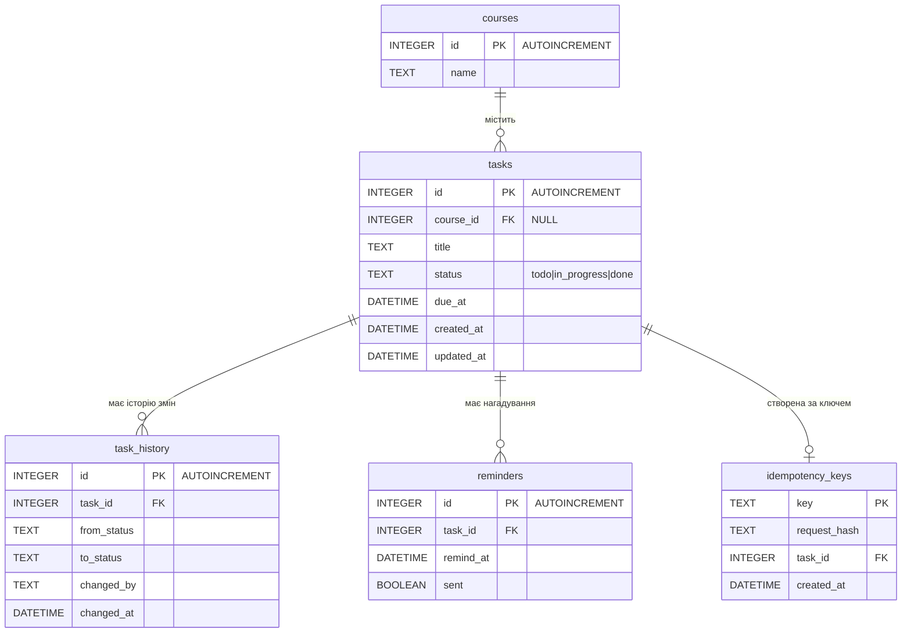

# DeadlineHub — специфікація

## 1. Межі

- **У межах:** REST API (JSON) для задач одного студента: створення, перегляд, список, зміна статусу, історія.
- **Ініціатор:** заголовок `X-User-Id`, якому довіряємо без перевірки; без заголовка — `anonymous`. Пишеться в лог і в `task_history.changed_by`.
- **Поза межами:** авторизація, таблиця користувачів, колаборація, UI, CRUD курсів через API (курси — із `server/db/seed.sql`), серверні ретраї (повтор робить клієнт, безпечно завдяки `Idempotency-Key`).
- **Наступні завдання:** нагадування (`reminders`) — зараз лише таблиця в схемі.

## 2. Модулі та взаємодія

| Модуль                | Відповідальність                                                                                                                                                                | Може залежати від                                      |
| --------------------- | ------------------------------------------------------------------------------------------------------------------------------------------------------------------------------- | ------------------------------------------------------ |
| `server/domain`       | `Task`, об'єкти станів, валідація вхідних даних (JSON Schema у `domain/schemas.js` і правила в коді), доменні помилки (`domain/errors.js`)                                      | —                                                      |
| `server/services`     | `TaskService`: виконання команд, список через стратегії, публікація подій; опис портів сховища                                                                                  | `domain`                                               |
| `server/repositories` | SQLite-реалізації портів, `transaction(fn)`; **лише тут SQL і транзакції**. `repositories/memory/` — in-memory реалізації тих самих портів (прототип, unit-тести)               | `domain`, `db`, `context`                              |
| `server/context.js`   | `AsyncLocalStorage` (`node:async_hooks`): `{ requestId, userId }`; `getContext()`, `log` (логер, що домішує `requestId`, `userId`)                                              | —                                                      |
| `server/db`           | підключення `bun:sqlite`, `schema.sql`, `seed.sql`, ініціалізація схеми                                                                                                         | —                                                      |
| `server/routes`       | HTTP: розбір запиту й заголовків, валідація за JSON Schema (Ajv у Fastify), виклик сервісу; без `try/catch`: помилки ловить один `setErrorHandler`                              | `services`, `domain` (лише `errors.js` і `schemas.js`) |
| `server/main.js`      | composition root: створює БД і репозиторії, передає їх у сервіс через конструктор, реєструє стратегії й підписників, хук `onRequest` для контексту, глобальний обробник помилок | усі                                                    |
| `tests`               | unit (domain, services з in-memory репозиторіями) і API-тести через `app.inject()` на `bun:test`                                                                                | усі                                                    |

Заборонені залежності (перевірка `C3`): `domain` → будь-що з `server/`, `fastify`, `bun:sqlite`; `services` → `repositories`, `db`, `routes`, `fastify`, `bun:sqlite`; `routes` → `repositories`, `db`, будь-що з `domain`, крім `domain/errors.js` і `domain/schemas.js`. `bun:sqlite` імпортують лише `server/db` і `server/repositories`; підключення створює `main.js` через `server/db`. `services` можуть імпортувати `context.js` (лише `log` і `getContext`).

### Залежності, контекст і логування

- **Ресурси** (БД, репозиторії, `now`) передаються один раз: через конструктор `TaskService` у `main.js`. Довгих списків параметрів немає.
- **Контекст запиту**: хук `onRequest` викликає `als.enterWith({ requestId: request.id, userId })`. `request.id` береться з вхідного `X-Request-Id`, а якщо його немає, генерується `crypto.randomUUID()`; ID повертається в заголовку відповіді `X-Request-Id`. Сервіс бере ініціатора з `getContext().userId`; ID вручну по викликах не передається.
- **Логер**: pino (вбудований у Fastify) з `mixin: () => getContext()`, тому **кожен** рядок логу з будь-якого рівня містить `requestId` і `userId`. Репозиторії логують кожен SQL-виклик (`debug`: операція, тривалість, кількість рядків або помилка). Сервіс логує бізнес-операції (`info`: `task.created`, `task.status_changed`). Глобальний обробник логує помилки (`warn` для 4xx, `error` для 5xx).
- Рішення й альтернативи (явний `ctx`, DI-контейнер) — в ADR `0010-dependency-context-choice.md`.

### Патерни

| Патерн         | Де                                                        | Контракт                                                                                                                                                                                                         |
| -------------- | --------------------------------------------------------- | ---------------------------------------------------------------------------------------------------------------------------------------------------------------------------------------------------------------- |
| **State**      | `domain/states.js`                                        | `TodoState`, `InProgressState`, `DoneState` з `canTransitionTo(status)`. `task.changeStatus(to)` делегує поточному стану; заборонений перехід → `InvalidTransitionError` (400).                                  |
| **Strategy**   | `services/strategies/`                                    | `{ apply(tasks, { now }) → tasks }`: `StatusFilter`, `CourseFilter`, `OverdueOnly`, `ByDueDate`. Сервіс отримує реєстр «параметр запиту → стратегія» з `main.js`; нова стратегія = новий файл + рядок у реєстрі. |
| **Command**    | `services/commands/`                                      | `CreateTaskCommand`, `ChangeStatusCommand`: `execute({ repos, now }) → event`. `TaskService.run(command)` виконує команду в транзакції.                                                                          |
| **Observer**   | `services/events.js`                                      | `subscribe(type, fn)`, `publish(event)`. Підписники: `HistoryRecorder` (синхронно, в тій самій транзакції); `ReminderScheduler` — у наступних завданнях.                                                         |
| **Repository** | порти в `services/ports.js`, реалізації в `repositories/` | `TaskRepository { save, findById, list }`, `CourseRepository { findById }`, `HistoryRepository { append, listByTaskId }`, `transaction(fn)`.                                                                     |

## 3. API

| Метод і шлях              | Тіло / параметри                                                      | Успіх                                                                                                   | Помилки      |
| ------------------------- | --------------------------------------------------------------------- | ------------------------------------------------------------------------------------------------------- | ------------ |
| `POST /tasks`             | `{ title, dueAt, courseId? }`; заголовок `Idempotency-Key?`           | `201` задача                                                                                            | `400`, `409` |
| `GET /tasks/:id`          | —                                                                     | `200` задача                                                                                            | `404`        |
| `GET /tasks`              | `status`, `courseId`, `overdue=true`, `sort=dueAt` (за замовчуванням) | `200` масив                                                                                             | `400`        |
| `PATCH /tasks/:id/status` | `{ status }`                                                          | `200` задача                                                                                            | `400`, `404` |
| `GET /tasks/:id/history`  | —                                                                     | `200` масив за `changedAt`                                                                              | `404`        |
| `GET /health`             | —                                                                     | `200 { "status": "ok" }`                                                                                | —            |
| `GET /version`            | —                                                                     | `200 { "version": "<sha>" }` (sha коміту: `GIT_SHA` або `git rev-parse --short HEAD`, інакше `unknown`) | —            |

```json
{
  "id": 1,
  "title": "Лабораторна 3",
  "courseId": 1,
  "courseName": "Програмування",
  "status": "todo",
  "dueAt": "2026-12-01T21:00:00.000Z",
  "createdAt": "…",
  "updatedAt": "…",
  "overdue": false
}
```

- `overdue = status ≠ done && dueAt < now` — обчислюється, не зберігається.
- `courseName` — `null`, якщо `courseId = null`.
- Заголовки: запит — `X-User-Id?`, `X-Request-Id?`, `Idempotency-Key?` (лише `POST /tasks`, 1..64 символи); відповідь — `X-Request-Id` завжди.
- Помилка: `{ "error": { "code": "VALIDATION_ERROR" | "INVALID_TRANSITION" | "NOT_FOUND" | "IDEMPOTENCY_CONFLICT" | "SOURCE_UNAVAILABLE" | "INTERNAL", "message": "…", "requestId": "…" } }`. Для `500` `message` загальний, стек і SQL віддаються лише в лог.
- Усі часи — ISO 8601 UTC. Час (`now`) інжектується в сервіс, щоб тести були детермінованими.

## 4. Дані



Обмеження: `PRAGMA foreign_keys = ON`; `tasks.status` — `CHECK IN ('todo','in_progress','done') DEFAULT 'todo'`; `task_history.from_status` — `NULL` для запису про створення; `task_history.changed_by` — `NOT NULL`; `reminders.sent` — `DEFAULT 0`; `idempotency_keys.request_hash` — SHA-256 нормалізованого тіла. `PRAGMA journal_mode = WAL`.

**Запити (лише в `repositories/`):**

| Порт                      | SQL                                                                                                  |
| ------------------------- | ---------------------------------------------------------------------------------------------------- |
| `TaskRepository.list`     | `SELECT t.*, c.name AS course_name FROM tasks t LEFT JOIN courses c ON c.id = t.course_id` (1 запит) |
| `TaskRepository.findById` | той самий `SELECT … WHERE t.id = ?`                                                                  |
| `TaskRepository.save`     | `INSERT INTO tasks …` / `UPDATE tasks SET status = ?, updated_at = ? WHERE id = ?`                   |
| `HistoryRepository`       | `INSERT INTO task_history …`; `SELECT … WHERE task_id = ? ORDER BY changed_at, id`                   |
| `IdempotencyRepository`   | `SELECT … WHERE key = ?`; `INSERT INTO idempotency_keys …`                                           |
| `transaction(fn)`         | `db.transaction(fn)` з `bun:sqlite` (BEGIN/COMMIT, ROLLBACK на виняток)                              |

Фільтри (`status`, `courseId`, `overdue`) і сортування лишаються стратегіями в пам'яті над результатом `list` (обсяг — одиниці сотень задач).

## 5. Оновлення даних за сценаріями

**S1. Створення задачі — `POST /tasks`**

1. Fastify перевіряє тіло за JSON Schema з `domain/schemas.js` (типи, обов'язкові поля, формат `dueAt`). Порушення → `400 VALIDATION_ERROR`, сервіс не викликається.
2. `routes` передає тіло й `Idempotency-Key` у `TaskService.run(new CreateTaskCommand(input, key))`.
3. Якщо ключ є і вже збережений: хеш тіла збігається → повертаємо `201` з тією самою задачею, нічого не пишемо; хеш не збігається → `409 IDEMPOTENCY_CONFLICT`.
4. Валідація в `domain` (правила, які JSON Schema не виражає): `title` 3..120 символів після `trim`; `dueAt > now`. Перевірка в `CreateTaskCommand` (`services`): `courseId` — `null`/відсутній або існує (`CourseRepository.findById`). Порушення → `400`, нічого не записано.
5. Транзакція: `INSERT tasks` (`status = 'todo'`, `created_at = updated_at = now`) → `INSERT idempotency_keys` (якщо ключ є) → подія `task.created` → `HistoryRecorder`: `INSERT task_history (NULL → 'todo', changed_by)`. Конкурентний дубль ключа (порушення PK) обробляється як у кроці 3.
6. `201` + задача.

**S2. Зміна статусу — `PATCH /tasks/:id/status`**

1. `TaskService.run(new ChangeStatusCommand(id, status))`.
2. `TaskRepository.findById` → немає → `404`.
3. `task.changeStatus(status)` через State → заборонено → `400`, нічого не змінено.
4. Транзакція: `UPDATE tasks SET status, updated_at = now` → подія `task.status_changed` → `HistoryRecorder`: `INSERT task_history (from → to, changed_by)`. Помилка будь-якого кроку → відкат обох.
5. `200` + задача.

**S3. Список — `GET /tasks`** — лише читання: `TaskRepository.list()` (один запит із `JOIN courses`; варіант із `CourseRepository.findById` на кожну задачу — це N+1, заборонено) → стратегії з реєстру за параметрами запиту по черзі → `overdue` для кожної задачі.

**S4. Історія — `GET /tasks/:id/history`** — лише читання: `404`, якщо задачі немає; інакше `HistoryRepository.listByTaskId`.

**Сценарії помилок** — усі мапить один `setErrorHandler` у `main.js`:

| Ситуація                                                | Відповідь                  | Стан БД              |
| ------------------------------------------------------- | -------------------------- | -------------------- |
| Невалідне тіло/параметри, бізнес-правило                | `400 VALIDATION_ERROR`     | без змін             |
| Заборонений перехід                                     | `400 INVALID_TRANSITION`   | без змін             |
| Задачі немає                                            | `404 NOT_FOUND`            | без змін             |
| `Idempotency-Key` з іншим тілом                         | `409 IDEMPOTENCY_CONFLICT` | без змін             |
| БД недоступна, `SQLITE_BUSY`/`LOCKED`, I/O; без ретраїв | `503 SOURCE_UNAVAILABLE`   | транзакцію відкочено |
| Будь-яка інша помилка                                   | `500 INTERNAL`             | транзакцію відкочено |

### Етапи

1. **Прототип:** усі сценарії S1–S4 через HTTP API на `repositories/memory/` (дані з фікстури, без БД); окремий коміт.
2. **Інтеграція БД:** `main.js` підключає SQLite-репозиторії; маршрути й сервіс не змінюються.

## 6. Критерії прийняття

Назва кожного тесту починається з `AC-N:`. Колонка «Завдання» — у якому завданні курсу критерій реалізується; C5 (`make ac-check`) вимагає тести лише для AC завдань ≤ `TASK` у `Makefile`. Перевірка одного критерію: `make ac ID=AC-N` (`bun test -t "AC-N:"`).

| ID    | Завдання | Критерій                                                                                                                                                              | Перевірка          |
| ----- | :------: | --------------------------------------------------------------------------------------------------------------------------------------------------------------------- | ------------------ |
| AC-1  |    2     | `POST /tasks` з валідними даними → `201`, `status = todo`, у `task_history` один запис `NULL → todo`.                                                                 | `make ac ID=AC-1`  |
| AC-2  |    2     | `title` коротший за 3 або довший за 120 символів після `trim` → `400 VALIDATION_ERROR`, у БД нічого не записано.                                                      | `make ac ID=AC-2`  |
| AC-3  |    2     | `dueAt` відсутній, некоректний або не в майбутньому → `400 VALIDATION_ERROR`.                                                                                         | `make ac ID=AC-3`  |
| AC-4  |    2     | Неіснуючий `courseId` → `400`; `courseId` відсутній або `null` → `201` з `courseId: null`.                                                                            | `make ac ID=AC-4`  |
| AC-5  |    2     | `GET /tasks/:id` → `200` для існуючої задачі, `404 NOT_FOUND` для неіснуючої.                                                                                         | `make ac ID=AC-5`  |
| AC-6  |    2     | `GET /tasks?status=…&courseId=…` повертає лише задачі, що відповідають усім фільтрам; невідоме значення `status` → `400`.                                             | `make ac ID=AC-6`  |
| AC-7  |    2     | Список відсортовано за `dueAt` за зростанням; `overdue = true` лише для невиконаних задач із `dueAt < now`.                                                           | `make ac ID=AC-7`  |
| AC-8  |    2     | `GET /tasks?overdue=true` повертає лише прострочені задачі.                                                                                                           | `make ac ID=AC-8`  |
| AC-9  |    2     | Переходи `todo→in_progress`, `in_progress→done`, `in_progress→todo` → `200`, `updatedAt` оновлено.                                                                    | `make ac ID=AC-9`  |
| AC-10 |    2     | `todo→done`, будь-який перехід із `done`, перехід у той самий або невідомий статус → `400`, `tasks` і `task_history` без змін.                                        | `make ac ID=AC-10` |
| AC-11 |    2     | `PATCH /tasks/:id/status` для неіснуючої задачі → `404`.                                                                                                              | `make ac ID=AC-11` |
| AC-12 |    2     | Якщо запис в історію падає, статус задачі не змінюється (одна транзакція).                                                                                            | `make ac ID=AC-12` |
| AC-13 |    2     | `GET /tasks/:id/history` повертає всі зміни в хронологічному порядку; `404` для неіснуючої задачі.                                                                    | `make ac ID=AC-13` |
| AC-14 |    2     | Нова стратегія, зареєстрована в тесті, застосовується без зміни `TaskService`.                                                                                        | `make ac ID=AC-14` |
| AC-15 |    1     | Межі модулів із розділу 2 не порушено.                                                                                                                                | `make boundaries`  |
| AC-16 |    1     | `GET /version` → `200 { "version" }` із sha, переданим у `buildApp`.                                                                                                  | `make ac ID=AC-16` |
| AC-17 |    2     | Повторний `POST /tasks` з тим самим `Idempotency-Key` і тілом → `201` з тим самим `id`; у `tasks` і `task_history` по одному запису.                                  | `make ac ID=AC-17` |
| AC-18 |    2     | Той самий `Idempotency-Key` з іншим тілом → `409 IDEMPOTENCY_CONFLICT`, у БД нічого не додано.                                                                        | `make ac ID=AC-18` |
| AC-19 |    2     | Усі рядки логу одного запиту (route, service, repository з SQL-операціями, обробник помилок) містять однаковий `requestId`, що збігається з `X-Request-Id` відповіді. | `make ac ID=AC-19` |
| AC-20 |    2     | `X-User-Id` потрапляє в `task_history.changed_by` і в лог; без заголовка — `anonymous`.                                                                               | `make ac ID=AC-20` |
| AC-21 |    2     | Збій БД (закрите підключення / `SQLITE_BUSY`) → `503 SOURCE_UNAVAILABLE`; непередбачена помилка → `500 INTERNAL` без стека в тілі; в обох випадках є `requestId`.     | `make ac ID=AC-21` |
| AC-22 |    2     | `GET /tasks` виконує рівно один SQL-запит незалежно від кількості задач; `courseName` заповнено.                                                                      | `make ac ID=AC-22` |
| AC-23 |    2     | У `server/routes` немає `try/catch` і SQL; SQL і транзакції є лише в `server/repositories` (правило ESLint `no-restricted-syntax` + dependency-cruiser).              | `make check`       |
